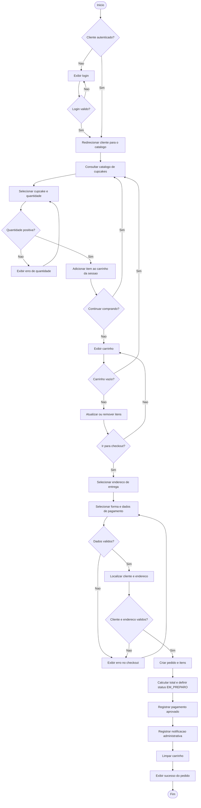

# Diagrama de atividades — compra de cupcakes

As areas `/carrinho/**` e `/checkout/**` exigem a autoridade
`ROLE_CLIENTE`. A area administrativa, que recebe as notificacoes e gerencia
os pedidos, exige `ROLE_ADMIN`.

