# Diagrama de casos de uso

O diagrama representa as principais interações dos atores com a aplicação
Cupcakes Gourmet.

```mermaid
flowchart LR
    Visitante([Visitante])
    Cliente([Cliente<br/>ROLE_CLIENTE])
    Administrador([Administrador<br/>ROLE_ADMIN])
    Sistema([Sistema Cupcakes Gourmet])

    subgraph Publico["Funcionalidades públicas"]
        UC01((Consultar catálogo))
        UC02((Acessar login))
        UC03((Cadastrar-se))
    end

    subgraph ClienteArea["Área do cliente"]
        UC04((Autenticar-se))
        UC05((Gerenciar carrinho))
        UC06((Adicionar cupcake))
        UC07((Atualizar quantidade))
        UC08((Remover item))
        UC09((Realizar checkout))
        UC10((Selecionar endereço))
        UC11((Informar pagamento))
        UC12((Acompanhar pedidos))
        UC13((Consultar detalhes do pedido))
        UC14((Gerenciar endereços))
        UC15((Gerenciar favoritos))
        UC16((Atualizar perfil))
        UC17((Consultar status do pedido))
        UC18((Encerrar sessão))
    end

    subgraph AdminArea["Área administrativa"]
        UC19((Gerenciar cupcakes))
        UC20((Consultar pedidos))
        UC21((Consultar detalhes do pedido))
        UC22((Atualizar status do pedido))
        UC23((Consultar notificações))
        UC24((Consultar relatórios de vendas))
        UC25((Consultar pedidos atualizados<br/>via API))
    end

    Visitante --> UC01
    Visitante --> UC02
    Visitante --> UC03

    Cliente --> UC01
    Cliente --> UC04
    Cliente --> UC05
    Cliente --> UC09
    Cliente --> UC12
    Cliente --> UC14
    Cliente --> UC15
    Cliente --> UC16
    Cliente --> UC17
    Cliente --> UC18

    UC05 -. inclui .-> UC06
    UC05 -. inclui .-> UC07
    UC05 -. inclui .-> UC08
    UC09 -. inclui .-> UC10
    UC09 -. inclui .-> UC11
    UC12 -. inclui .-> UC13

    Administrador --> UC04
    Administrador --> UC19
    Administrador --> UC20
    Administrador --> UC22
    Administrador --> UC23
    Administrador --> UC24
    Administrador --> UC25
    UC20 -. inclui .-> UC21

    UC01 -. usa .-> Sistema
    UC03 -. persiste usuario e cliente .-> Sistema
    UC05 -. usa carrinho de sessao .-> Sistema
    UC09 -. cria pedido e pagamento .-> Sistema
    UC19 -. persiste cupcakes .-> Sistema
    UC20 -. consulta pedidos .-> Sistema
    UC24 -. consolida vendas .-> Sistema
```

## Atores

| Ator | Descrição |
|---|---|
| Visitante | Usuário não autenticado que acessa o catálogo, login ou cadastro. |
| Cliente | Usuário autenticado com autoridade `ROLE_CLIENTE`, responsável pela compra e acompanhamento dos pedidos. |
| Administrador | Usuário autenticado com autoridade `ROLE_ADMIN`, responsável pela operação da loja e pelos relatórios. |

## Regras de acesso

- `/`, `/catalogo`, `/login` e `/registrar` são acessíveis ao visitante.
- `/carrinho/**`, `/checkout/**` e `/cliente/**` exigem `ROLE_CLIENTE`.
- `/admin/**` exige `ROLE_ADMIN`.
- O login utiliza Spring Security e redireciona o administrador para o painel
  administrativo e o cliente para o catálogo.

