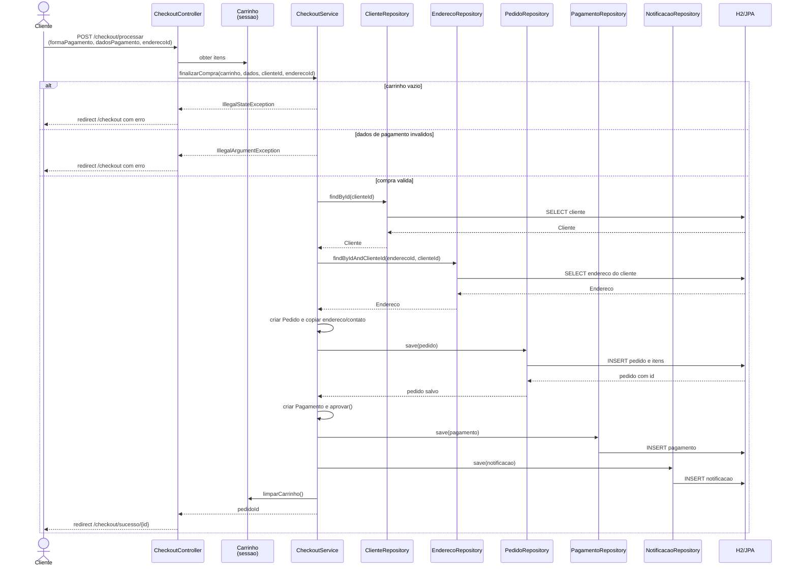

# Diagrama de sequência — checkout

O fluxo abaixo representa a finalização de uma compra iniciada por um cliente
autenticado, desde o envio do formulário até a limpeza do carrinho.

Todas as operações de persistencia da finalizacao sao executadas pelo método
transacional `CheckoutService.finalizarCompra`.

